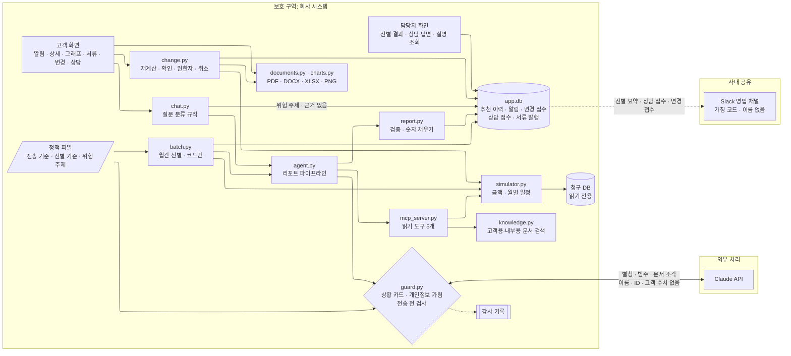
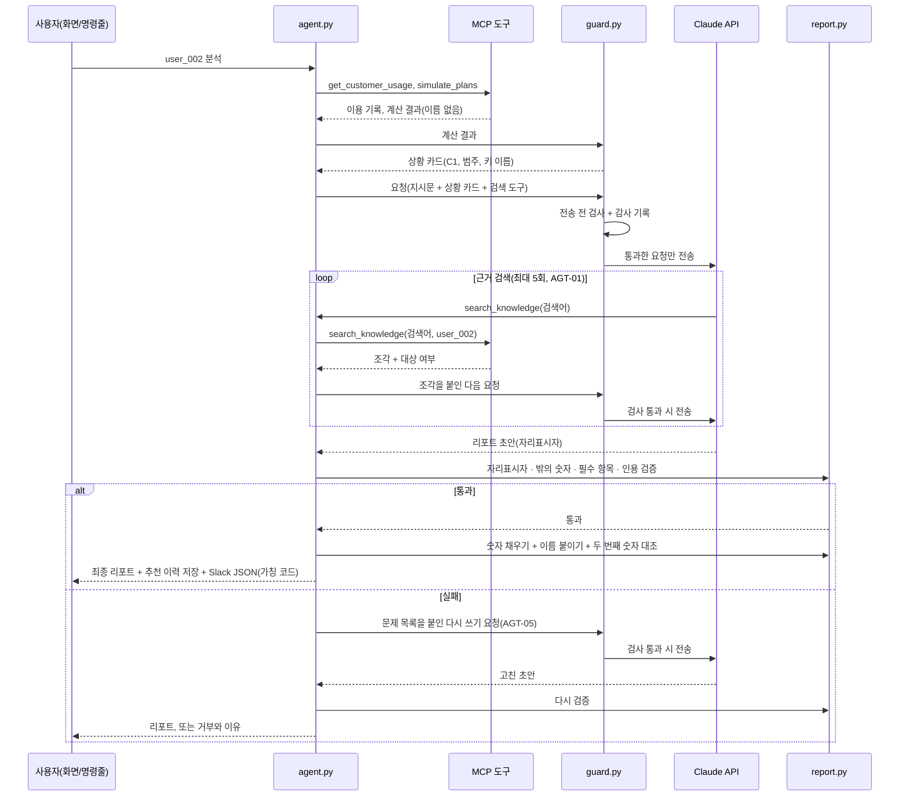

# 실행 계획 (v2.2, 2026-11-07 G1 변경 3 승인)

SDD 골격의 **계획** 문서입니다. 무엇을 만들지는 [requirements.md](requirements.md)(명세)에, 어떤 순서로 만들지는 [tasks.md](tasks.md)(작업)에 있습니다. 이 문서는 그 사이에서 **어떤 구조로 만들지**를 정합니다.

| 버전 | 날짜 | 내용 |
|---|---|---|
| v1 | 2026-11-07 | 순차 패턴, 아키텍처, 실행 흐름, 리포트 구성 |
| v1.1 | 2026-11-07 | 아키텍처 검토 반영: 수집·분석을 코드가 먼저 실행, 숫자 자리표시자, 고객 별칭, 추천 안정성, 위험 표 갱신 |
| v1.2 | 2026-11-07 | 데이터 보안 반영: 상황 카드, 전송 전 검사, 감사 기록, 보안 구역. 상세는 [security.md](security.md) |
| v1.4 | 2026-11-07 | 이벤트 자리표시자 5개 추가, 자리표시자 등록 파일(5.3) |
| v1.3 | 2026-11-07 | 보안 결정 확정 반영: 전송 정책 파일, Slack 가칭 코드와 사내 조회, 추천 이력 저장소, 데이터별 보관 기간 |
| **v2.0** | 2026-11-07 | **고객 대상 제품으로 범위 변경(명세 v3.0)**: 세 흐름(월간 선별, 고객 화면, 담당자 화면), AI 상담·셀프 변경 흐름, 서류·그래프, 아키텍처 그림 다시 그림 |
| v2.1 | 2026-11-07 | 성수기 사전 알림(명세 v3.2): 4.4 성수기 흐름, 자리표시자 키 추가, 위험 표 갱신 |
| v2.2 | 2026-11-07 | 과정 자료 대조 반영(명세 v3.3): 4.5 개발·운영·배포 구조, 과정 패턴과의 대응표, 파일 구성 추가, 위험 표 갱신 |

## 1. 한 줄 요약

(v2.0) 매달 **코드가 전체 고객을 계산해 알림 대상을 고르고**, 고객별 추천 리포트는 아래의 **순차 파이프라인**이 만듭니다. 고객은 알림을 보고 **직접 바꾸거나**(AI 없이 시스템 값만으로), **AI 상담에 묻거나**, **담당자와 연결**됩니다. 돈과 관련된 숫자(요금, 절감액, 서류, 그래프)는 모두 시뮬레이터가 만들고, AI는 설명 문장과 근거 찾기만 맡습니다.

**리포트 파이프라인**: **코드**가 수집과 분석을 먼저 끝내고, **Claude**는 근거 검색과 리포트 작성만 맡으며, 다시 **코드**가 검증과 전달을 하는 순차적(Sequential) 파이프라인입니다. 숫자는 시뮬레이터가, 문장 근거는 문서 검색(RAG)이 책임집니다. Claude는 숫자를 직접 쓰지 않고 자리표시자만 씁니다. 그래서 Claude에는 고객의 숫자를 보낼 필요가 없고, 실제로 보내지 않습니다. Claude가 받는 고객 정보는 별칭과 범주 정보뿐인 **상황 카드**이고, 모든 요청은 보내기 직전에 **전송 전 검사**를 거칩니다([security.md](security.md)).

## 2. 오케스트레이션 패턴: 코드가 지휘하는 계층 + 고객별 순차

### 2.0 세 흐름 (v2.0)

| 흐름 | 시작 | 지휘 | AI가 하는 일 | 요구사항 |
|---|---|---|---|---|
| **월간 선별** | 청구 마감 후 자동 | `batch.py`(코드). 전원 계산 → 기준으로 선별 → 고객마다 리포트 파이프라인 실행 → 알림 미리보기·사내 요약 | 고객별 설명 문장(아래 2.1의 3·4단계) | PRO |
| **고객 화면** | 고객이 알림을 엶 | 화면 코드. 셀프 변경(`change.py`)과 서류(`documents.py`)에는 AI가 없음. 상담은 `chat.py`의 규칙이 먼저 분류 | 상담 답변 문장(규칙을 통과한 질문만) | CHG, DOC, VIZ, ASK |
| **담당자 화면** | 담당자 | 화면 코드 | 없음 | ESC, UI |

월간 선별은 **관리자(코드)가 고객마다 같은 순차 파이프라인을 실행시키는 계층 구조**입니다. 관리자를 AI가 아닌 코드로 둔 이유는, 선별이 계산만으로 충분하고 매달 같은 기준으로 돌아야 하기 때문입니다(요구사항 5장 21번).

### 2.1 리포트 파이프라인의 단계


| 단계 | 하는 일 | 담당 | 도구·모듈 | 결과 | 요구사항 |
|---|---|---|---|---|---|
| 1. 수집 | 고객 이용 기록 조회 | **코드** | `get_customer_usage` | 이용 기록(이름 없음) | RET-01~03, AGT-02 |
| 2. 분석 | 요금제·이벤트별 12개월 총액 비교, 추천, 절감액, 추천 안정성 | **코드(시뮬레이터)** | `simulate_plans` | 금액, 추천, 받을 수 없는 이벤트와 이유, 이탈 위험, 안정성 | SIM-01~04, AGT-02 |
| 3. 근거 검색 | 상황 카드를 보고 추천 이유와 응대 방법의 근거 찾기 | **Claude**가 검색어를 정하고, 코드가 검색 | `search_knowledge` (Claude가 쓰는 유일한 도구, 최대 5회) | 문서 조각(ID, 제목, 본문, 대상 여부) | KNW-01~06, AGT-01 |
| 4. 작성 | 4단 구성 리포트를 자리표시자로 작성 | **Claude** | — | 리포트 초안 | REP-01, REP-02 |
| (3·4단계의 매 요청) | 상황 카드 만들기, 전송 전 검사, 감사 기록 | **코드** | `guard.py` | 통과한 요청만 전송 | SEC-07, 08, 11 |
| 5. 검증 | 자리표시자, 자리표시자 밖 숫자, 필수 항목, 인용 확인 | **코드** | `report.py` | 통과, 또는 거부와 이유 | REP-02~05, AGT-05 |
| 6. 전달 | 숫자 채우기, 고객 이름 붙이기, 추천 이력 저장, Slack 메시지 만들기(가칭 코드), (요청 시) 전송 | **코드** | `report.py`, `history.py` | 최종 리포트, 추천 이력, Slack JSON | SEC-03, 10, 12, 15, NTF-01~04 |

AI가 판단하는 곳은 3단계와 4단계뿐입니다. 3단계에서는 분석 결과를 보고 무엇을 찾을지 정합니다. 예를 들어 이탈 위험이 있으면 이탈 응대 가이드를, 하향 추천이면 하향 시 유의사항을, 사용량 변화에 민감하면 재검토 안내를 찾습니다. 4단계에서는 고객에게 어떻게 설명할지 정합니다. 1·2단계와 5·6단계는 늘 같은 일을 하므로 코드가 합니다(요구사항 5장 12번).

### 2.2 순차적을 고른 이유

1. **각 단계가 앞 단계 결과에 기대고 있습니다.** 검색어는 분석 결과를 봐야 정할 수 있습니다. 리포트는 계산 결과와 근거가 모두 있어야 쓸 수 있습니다. 나눠서 동시에 할 일이 없습니다.
2. **검증 지점을 한 곳에 둘 수 있습니다.** 마지막 출력 바로 앞에서 숫자와 인용을 한 번에 확인합니다.
3. **비용과 재현성.** Claude를 부르는 단계가 둘뿐이라 API 왕복이 적습니다. 결과가 매번 달라질 여지도 적습니다(SIM-03, KNW-02의 취지).

### 2.3 다른 패턴을 쓰지 않은 이유

| 패턴 | 쓰지 않은 이유 |
|---|---|
| 계층적(Hierarchical) | 관리자 에이전트가 나눠 맡길 만한 독립 작업이 없습니다. 하위 에이전트끼리 결과를 넘기는 비용만 늘어납니다. 과정 가이드의 서브에이전트 3개(`db-reader`, `calc-engine`, `proposal-writer`)는 같은 역할을 위 표의 단계로 나눴습니다. 그중 `db-reader`와 `calc-engine`은 판단할 것이 없어 코드가 맡습니다. |
| 공동 협업(Joint Collaboration) | 에이전트끼리 주고받는 경로가 많아집니다. 그러면 같은 입력에 다른 결과가 나올 수 있고, 리포트의 숫자가 어디서 왔는지 따라가기 어렵습니다. 이 프로젝트의 핵심인 숫자 보장(REP-02)과 맞지 않습니다. |

**v2.0에서 범위 안으로 들어온 것**: 처음에는 "전체 고객 일괄 분석"을 범위 밖의 확장으로 두었습니다. 선제 알림이 첫 기획의 핵심이라는 점이 확인되어 월간 선별로 넣었습니다(2.0). 위 표의 "계층적을 쓰지 않은 이유"는 **AI 에이전트끼리의 계층**에 대한 것이고, 코드가 관리자인 계층과는 다릅니다.

## 3. 아키텍처



- (v2.0) 고객 화면, 담당자 화면, 월간 선별은 모두 보호 구역(회사 시스템) 안에서 돕니다. 시연에서는 PC 한 대의 Streamlit 화면 둘로 보여줍니다.
- **보안 구역은 셋입니다**(security.md 3장). PC 밖으로 나가는 것은 Claude API로 가는 요청과, 요청했을 때의 Slack 전송 두 가지뿐입니다.
  - **외부 처리(Claude)**: 상황 카드(별칭 `C1`, 요금제·이벤트 이름, 범주 정보, 자리표시자 이름)와 가상 문서 조각만 갑니다. 고객 이름, 고객 ID, 고객 수치는 가지 않습니다(SEC-03, 05, 07).
  - **전송 전 검사**: Claude로 가는 모든 요청은 `guard.py`가 보내기 직전에 검사합니다. 걸리면 보내지 않고 멈춥니다(SEC-08). 통과·차단 모두 감사 기록에 남습니다(SEC-11).
  - 별칭과 고객 ID의 연결은 `agent.py` 메모리 안에만 있습니다. Claude가 검색 도구를 부르면, `agent.py`가 실행 직전에 별칭을 ID로 바꿉니다.
  - **사내 공유(Slack)**: 금액과 고정 가칭 코드가 갑니다. 고객 이름과 고객 ID는 가지 않습니다. 담당자는 사내 화면에서 코드를 조회해 실제 이름을 봅니다(SEC-12, 16).
  - **정책 파일**: 무엇을 외부로 보낼지, 범주 구간, 허용 모델, 보관 기간은 `config/data_policy.toml`이 정합니다. 승인 정보가 없으면 실행하지 않습니다(SEC-14).
  - **앱 저장소**: 추천 이력, 알림, 변경 접수, 상담 접수, 서류 발행 기록은 앱 전용 저장소 `data/app.db`에 가칭 코드로 남깁니다. 청구 DB는 계속 읽기 전용입니다(RET-01, SEC-15). 시연에서는 `change_requests` 표가 모의 청구 시스템 역할을 합니다.
- **MCP 서버 하나를 두 곳에서 씁니다.** `agent.py`는 같은 서버를 프로그램 안에서 바로 연결합니다(지금 테스트와 같은 방식). Claude Code에서는 `.mcp.json`으로 연결해 개발 중에 도구를 직접 시험합니다.
- **도구는 5개이고, Claude에게는 1개만 보입니다.** 지금 있는 4개에 `search_knowledge`를 더합니다. `agent.py`는 1·2단계에서 `get_customer_usage`, `simulate_plans`를 직접 부르고, Claude에게는 `search_knowledge`만 줍니다. SQL을 받는 도구는 여전히 없습니다(RET-02).

## 4. 고객 1명의 실행 흐름



## 4.1 AI 상담 흐름 (v2.0)

1. 고객이 질문을 적습니다. 화면에는 AI 상담이라는 안내가 먼저 보입니다(ASK-01).
2. `chat.py`가 **코드 규칙으로 먼저 분류**합니다(ASK-02).
   - 위험 주제·이상한 요청 → AI를 부르지 않고 상담 연결
   - 금액 질문 → 시뮬레이터 값을 자리표시자로 채운 정해진 문장
   - 조건·정책 질문 → 다음 단계로
3. 질문의 개인정보 형식을 가리고(ASK-05) 상황 카드와 함께 `guard.py`를 거쳐 Claude로 보냅니다. Claude는 **고객용 문서만** 검색할 수 있습니다(KNW-07).
4. 검색 결과가 비거나 답변 검증에 실패하면 자동으로 상담 연결(ASK-03). 통과하면 근거와 함께 답변을 보여줍니다.
5. 상담 연결이면 `tickets`에 접수, 접수 번호 안내, Slack에 요약 알림(ESC-01, 02).

## 4.2 셀프 변경 흐름 (v2.0) — AI 없음

1. 고객이 추천 상세에서 [이 요금제로 변경]을 누릅니다. 결제 권한자가 아니면 버튼 대신 요청 안내가 보입니다(CHG-04).
2. 최신 데이터로 다시 계산합니다. 알림 때와 다르면 새 값을 보여줍니다(CHG-02). 추천 유효기간이 지났으면 다시 계산한 결과로만 진행합니다(CHG-07).
3. 확인 화면: 변경 전후 요금제, 적용일, 공급가액·세액·합계, 할인 기간과 종료 후 요금, 취소 가능 기한, 세금계산서 발행 정보(CHG-03).
4. 확인을 누르면 `change_requests`에 접수(같은 접수 두 번 방지), 사내 채널 알림, 추천 이력 "셀프 수락", 감사 기록(CHG-06).
5. 변경 확인서를 PDF·DOCX·XLSX로 내려받습니다(DOC). 적용일 전까지 취소할 수 있습니다(CHG-05).

## 4.3 서류와 그래프 (v2.0)

- **같은 숫자 하나에서 모든 형식을**: `documents.py`가 시뮬레이터 결과와 월별 일정(SIM-05)으로 서류 데이터 하나를 만들고, 그것을 PDF·DOCX·XLSX로 각각 씁니다. 그래프 PNG는 `charts.py`가 같은 데이터로 그립니다. 형식마다 숫자가 다를 수 없게 하려는 구조입니다(DOC-03).
- **XLSX 구성**: `요약` 시트(현재·추천 12개월 합계, 절감액, 공급가액·세액·합계), `월별` 시트(12개월 × 기본·초과·할인·공급가액·세액·합계, 회계·예산 입력용으로 값만), `근거` 시트(최근 사용량, 단가 기준일). (v2.1) 성수기 고객은 `근거` 시트에 24개월 사용량과 예측 방법, `요약` 시트에 다가오는 성수기 항목.
- **그래프 3개**(VIZ-01): 12개월 누적 비용(현재 vs 추천), 월별 요금 구성, 최근 6개월 사용량과 기본 제공량. 화면에서는 대화형으로, 내려받기는 PNG로.
- **한글 글꼴**: PDF와 PNG에는 한글 글꼴이 들어가야 합니다. 설정으로 지정하고 기본은 Windows 맑은 고딕, 없으면 Noto Sans CJK를 씁니다. 회사 밖으로 배포하는 서류라면 오픈 라이선스 글꼴(Noto Sans KR 등)을 권합니다.

## 4.4 성수기 사전 알림 (v2.1) — AI 없음

1. **판정**(`simulator.py`): 기록이 24개월 이상인 고객의 성수기 월과 근거를 구합니다(SIM-07). 결과는 시뮬레이터 결과의 `seasonality`에 들어갑니다.
2. **예측**(`simulator.py`): 성수기가 있으면 비교 기간 12개월의 달별 예상 사용량을 계절 반영으로 만들고, 그것으로 월별 일정·12개월 총액·추천·안정성을 계산합니다(SIM-08). `forecast.method`에 `3개월 평균` 또는 `계절 반영`을 적습니다. 서류·그래프·해설은 이 결과를 그대로 쓰므로 따로 바꿀 계산이 없습니다.
3. **선별**(`batch.py`, T9): 묶음 첫 달, 신청 마감, 1차·마감 전 알림 날짜를 계산하고 PRO-07 조건으로 고릅니다. 변경 권유 / 예산 안내는 PRO-08 규칙으로 정합니다. 같은 달 절감 추천과 겹치면 합칩니다(PRO-09).
4. **고객 화면·서류**: 알림 미리보기, 추천 상세의 24개월 사용량 그래프(VIZ-05), 검토서의 "다가오는 성수기" 항목(DOC-08).
5. **확장(T11b)**: 성수기만 상향 후 복귀 예약(CHG-08).

새 시나리오 고객(T3b, 24개월 기록)은 의도가 정답으로 고정됩니다.

| 고객 | 의도 | 기대 결과 |
|---|---|---|
| `user_201` | 세무회계 사무소: 1~3월과 5월이 2년 연속 성수기, 성수기 사용량이 커서 연중 상위 요금제가 유리 | 성수기 판정, 계절 반영 예측으로 프로 + 전환 할인 추천(1,540,000 → 1,248,000원, 3개월 평균만 쓰면 유지), 기준일 선별에서 1차 알림(1월 묶음, 2026-11-17) |
| `user_202` | 온라인 선물 쇼핑몰: 설 명절 무렵 1~2월이 2년 연속 성수기, API 성장률 1.25, 성수기가 짧아 현재 요금제 유지가 유리 | 성수기 판정, 베이직 유지 + 장기 고객 할인(538,000 → 518,000원), 변경 권유 없이 예산 안내(1차 알림 2026-11-17) |
| `user_203` | 작년 8월에만 사용량이 튐 | 성수기 아님, 3개월 평균 예측, 성수기 알림 없음 |

## 4.5 개발·운영·배포 (v2.2)

**과정 자료의 패턴과 우리 구조의 대응** (발표에서 이 이름으로 설명합니다)

| 과정 자료의 패턴 | 우리 구조 |
|---|---|
| Routing (5주차) | 상담 질문을 코드 규칙으로 분류해 금액 답변 / 문서 근거 답변 / 담당자 연결로 보냄(ASK-02) |
| Prompt Chaining | 리포트 파이프라인: 수집 → 분석 → 근거 검색 → 작성 → 검증 → 전달(2.1) |
| Evaluator-Optimizer | 리포트 검증에 실패하면 문제 목록을 돌려주고 한 번 다시 쓰게 함(AGT-05) |
| Orchestrator-Workers / 계층형 | 월간 선별(코드)이 고객마다 같은 파이프라인을 실행(2.0) |
| Hybrid RAG(비정형 RAG + 정형 조회) | 문서 검색은 문장 근거에만, 숫자는 정해진 질의 도구와 계산 프로그램에서(NL2SQL은 쓰지 않음) |
| Harness: Context·Tool·Eval | 상황 카드(Context), 정해진 읽기 도구·MCP(Tool), 검증·평가 세트(Eval) |
| 검증 게이트·EARS·AC-테스트 1:1 | 승인 게이트 G1~G4, 요구사항-테스트 연결표, CI |
| 데이터 품질 게이트(2주차) | DQ-01~04 |
| MLOps 수명주기 | LLM 운영: CI, 평가 회귀, 운영 지표, 사람이 승인하는 개선 순환(OPS) |
| RAG 챗봇 4계층 + Azure(6주차) | 표현(Streamlit) · 생성(Claude) · 검색(앱 안 하이브리드) · 데이터(지식 문서, 청구 DB), 시연 때만 Azure 배포 |

**개발 하네스** (HAR): `CLAUDE.md`(규칙), `.claude/settings.json`(훅 등록), `.claude/hooks/guard_files.py`(보호 파일 차단), `.claude/hooks/run_tests.py`(고친 뒤 테스트). 훅은 파이썬이라 Windows에서도 같게 동작하고, 훅 자체를 `tests/test_hooks.py`가 확인합니다.

**CI** (OPS-01): `.github/workflows/ci.yml`이 push와 PR마다 Ubuntu에서 의존성 설치 → 한글 글꼴 설치 → `pytest`를 돌립니다. 비밀값 검사 테스트도 여기서 함께 돕니다.

**운영 지표와 개선 순환** (OPS-02~04): `metrics.py`가 앱 저장소와 실행 기록에서 월별 지표를 계산해 담당자 화면에 보여줍니다. 개선은 담당자가 월 1회 지표를 보고 정책 파일·지식 문서를 고친 뒤 평가를 다시 돌려 통과하면 반영합니다.

**배포** (DEP): `infra/main.bicep` + `azure.yaml`(azd). 앱 호스팅 1개(고객·담당자 화면을 경로로 나눔), Key Vault, 관리 ID, Application Insights, 예산 알림. `azd up` → 스모크 테스트 → 시연 영상 촬영 → `azd down`.

## 5. 리포트 구성과 자리표시자

### 5.1 4단 구성

과정 가이드의 4단계 추론(원인 분석 → 최적 요금제 → 절감액 → 응대 안내)을 리포트의 4단 구성으로 살립니다.

1. **현재 과금 분석**: 현재 요금제, 예상 월 청구액, 초과가 생기는 원인, 근거가 된 사용량
2. **추천**: 요금제와 이벤트, 추천 안정성, 추천 이유 `[근거: 문서ID#번호]`
3. **절감액**: 월 절감액, 12개월 절감액, 절감 비율
4. **응대 안내**: 고객에게 설명할 순서와 유의사항 `[근거: 문서ID#번호]`. 이탈 위험, 기록 부족(`low_data`), 사용량 변화에 민감한 경우를 함께 안내합니다.

기록이 없는 고객은 추천 없이, 기록이 없어 추천하지 않는다는 안내만 씁니다(REP-03).

### 5.2 자리표시자 키

Claude는 아래 키만 쓸 수 있습니다. Claude에는 키 **이름**만 보내고 값은 보내지 않습니다(SEC-07). Claude는 상황 카드의 범주 정보로 판단하고, 리포트에는 키를 씁니다. 값과 형식(쉼표, 단위)은 검증 뒤 코드가 채웁니다.

| 키 | 채워지는 값 (`user_002` 예) | 시뮬레이터 결과의 출처 |
|---|---|---|
| `{current_plan}` | 베이직 | `current_plan_name` |
| `{current_monthly}` | 129,000원 | 현재 요금제 `monthly.total` |
| `{current_base}` | 30,000원 | 현재 요금제 `monthly.base_price` |
| `{current_api_overage}` | 64,000원 | 현재 요금제 `monthly.api_overage` |
| `{current_storage_overage}` | 35,000원 | 현재 요금제 `monthly.storage_overage` |
| `{avg_api_calls}` | 42,000회 | `forecast.api_calls` |
| `{avg_storage_gb}` | 120GB | `forecast.storage_gb` |
| `{forecast_months}` | 3개월 | `forecast.months_used` |
| `{included_api_calls}` | 10,000회 | 현재 요금제 기본 제공량 |
| `{included_storage_gb}` | 50GB | 현재 요금제 기본 제공량 |
| `{rec_plan}` | 프로 | `recommendation.plan_name` |
| `{rec_monthly}` | 80,000원 | 추천 요금제 `monthly.total`(할인 전) |
| `{promo_name}` | 프로 전환 3개월 30% 할인 | 추천 요금제 `promotion.promo_name` |
| `{promo_discount_total}` | 72,000원 | 추천 요금제 `promotion.discount_total` |
| `{promo_discount}` | 30% (정액 이벤트면 "50,000원") | 이벤트 `discount_type`, `discount_value` |
| `{promo_months}` | 3개월 | 이벤트 `duration_months` |
| `{promo_valid_to}` | 2026-12-31 | 이벤트 `valid_to`(신청 마감일) |
| `{promo_min_tenure}` | 6개월 | 이벤트 `min_tenure_months`(필요한 가입 기간) |
| `{skipped_promo_reasons}` | "베이직 2년 이상 고객 2개월 1만 원 할인: 가입 24개월 이상 필요(현재 19개월) / 여름 프로 50% 할인(종료): 이벤트 기간 아님" | 받을 수 없는 이벤트와 이유(`skipped_promotions`). 고객의 가입 기간이 들어 있어 Claude에는 보내지 않고 PC 안에서만 채움(SEC-07) |
| `{saving_monthly}` | 49,000원 | `recommendation.monthly_saving` |
| `{saving_12m}` | 660,000원 | `recommendation.saving_12m` |
| `{saving_pct}` | 43% | `recommendation.saving_pct` |
| `{current_total_12m}` | 1,548,000원 | `recommendation.current_total_12m` |
| `{rec_total_12m}` | 888,000원 | `recommendation.recommended_total_12m` |
| `{horizon_months}` | 12개월 | 비교 기간 |
| `{activity_change_pct}` | (이탈 위험 고객만) -67% | `activity.change_pct` |
| `{stability}` | 사용량이 20% 줄거나 늘어도 같은 추천입니다 | 추천 안정성(SIM-04)으로 코드가 만든 문장 |
| `{peak_months}` | (성수기 고객만, `user_201` 예) 1~3월, 5월 | `seasonality.peak_months`(SIM-07) |
| `{peak_deadline}` | 2026-12-31 | 다음 성수기 묶음의 신청 마감일 |
| `{peak_bill_current}` | 855,000원 | 다음 묶음 기간의 예상 청구액, 현재 요금제 유지(공급가액, `seasonality.upcoming.current_bill`) |
| `{peak_evidence}` | 2025-01 평소의 5.0배, 2026-01 5.5배 | 두 해의 배수(`seasonality.evidence`, 코드가 만든 문장) |
| `{forecast_method}` | 3개월 평균 / 계절 반영 | `forecast.method`(SIM-08) |

- **필수 키**(REP-01): `{current_plan}`, `{current_monthly}`, `{rec_plan}`, 근거 사용량(`{avg_api_calls}` 또는 `{avg_storage_gb}`). 절감액이 0보다 크면 `{saving_monthly}`, `{saving_12m}`. 이벤트가 있으면 `{promo_name}`.
- 값이 없는 키(예: 이벤트가 없는 고객의 `{promo_name}`)를 쓰면 거부합니다.
- 키 목록과 예시 값은 T4에서 테스트로 고정합니다. 위 예시 값은 v2.4 단가 기준이며, T3에서 시뮬레이터 테스트의 기대값도 같은 값으로 다시 계산합니다.

이벤트 예시 문장: "{promo_name}을 받으면 {promo_months} 동안 기본 요금이 {promo_discount}만큼 줄고, {horizon_months} 기준 {saving_12m}을 절감합니다. 신청은 {promo_valid_to}까지입니다."

예시 문장: "현재 {current_plan} 요금제로 월 {current_monthly}이 예상됩니다. 최근 {forecast_months} 평균 API {avg_api_calls}를 사용해 기본 제공량 {included_api_calls}를 넘습니다."

### 5.3 자리표시자 등록 파일

자리표시자 키는 코드에 고정하지 않고 `config/placeholders.toml`에서 관리합니다. 이벤트 종류가 늘거나 리포트에 새 정보를 넣고 싶을 때, 검증 코드를 고치지 않고 키를 추가할 수 있게 하기 위해서입니다. 검증(REP-02)이 허용하는 키 목록과 숫자를 채우는 방법이 모두 이 파일에서 나옵니다.

```toml
[keys.promo_discount]
source = "promotion.discount"      # 시뮬레이터 결과에서 값을 가져오는 경로
format = "discount"                # won(원) / count(회) / gb / months(개월) / percent / date / discount(방식에 따라 % 또는 원) / text
required_when = "promotion"        # always / promotion / saving / never
local_only = false                 # true면 고객 데이터가 들어 있어 Claude에 키 이름만 보내고 값은 PC 안에서만 채움
description = "이벤트 할인값"

[keys.skipped_promo_reasons]
source = "skipped_promotions"
format = "text"
required_when = "never"
local_only = true
description = "받을 수 없는 이벤트와 이유(고객의 가입 기간 포함)"
```

키를 추가하는 경우는 두 가지입니다.

- **값이 이미 시뮬레이터 결과에 있을 때**(예: 이벤트 신청 시작일 `valid_from`): 등록 파일에 키만 추가하면 됩니다. 코드는 고치지 않습니다.
- **새로운 종류의 조건일 때**(예: 결합 상품 할인, 최소 계약 기간): DB 컬럼과 시뮬레이터 계산이 먼저 필요합니다. 계산이 바뀌므로 명세 변경(SDD 규칙 3)을 거칩니다. 조건 종류가 많아지면 `promotions` 표에 컬럼을 계속 늘리는 대신 조건을 행으로 두는 표(`promo_conditions`: 이벤트, 조건 종류, 값)로 바꾸는 것을 검토합니다(범위 밖).

등록 파일이 바뀌면 테스트가 다음을 확인합니다: 모든 키의 `source`가 시뮬레이터 결과에 실제로 있는지, `format`이 정해진 종류인지, `local_only` 키의 값이 상황 카드에 들어가지 않는지.

**참고(범위 밖)**: 사람이 읽는 안내 문서에도 숫자를 보여야 한다면, 문서에 `{{PROMO_PRO_UPGRADE.discount}}` 같은 표시를 쓰고 화면에 보일 때 DB 값으로 바꿔 넣는 방법이 있습니다. 숫자는 여전히 DB 한 곳에만 있습니다.

## 6. 파일 구성 (완성 시)

```
ai-billing-recommendation-agent/
├── README.md
├── requirements.txt          # 실행에 필요한 패키지(버전 고정)
├── requirements-dev.txt      # pytest
├── .env.example
├── .mcp.json                 # Claude Code에서 자체 MCP 서버 연결(Claude Code가 읽는 위치는 루트의 이 파일뿐)
├── config/data_policy.toml   # 전송 정책 · 범주 · 허용 모델 · 보관 기간 · 선별 기준 · 위험 주제(승인 기록 포함)
├── config/placeholders.toml  # 자리표시자 키 등록(5.3)
├── .streamlit/config.toml    # 접속 주소 127.0.0.1 (UI-01)
├── CLAUDE.md                 # 개발 규칙(HAR-01)
├── .claude/settings.json     # 훅 등록(HAR-02, 03)
├── .claude/hooks/           # guard_files.py, run_tests.py
├── .github/workflows/ci.yml  # 자동 테스트(OPS-01)
├── infra/, azure.yaml        # Azure 배포 코드(DEP, T16)
├── design/
│   ├── requirements.md       # 명세
│   ├── plan.md               # 계획(이 문서)
│   ├── tasks.md              # 작업과 승인 게이트
│   ├── security.md           # 데이터 보안 정책과 구조
│   └── architecture.png, sequence.png
├── database/
│   └── init_db.py            # 가상 데이터 생성(DB 파일은 저장소에 넣지 않음)
├── knowledge/                # 지식 문서(가상, 금액 없음, 메타데이터 포함)
├── src/
│   ├── data_access.py        # 청구 데이터 읽기 한 곳(RET-04, T3c 완료)
│   ├── settings.py           # 실행 설정: 분석 기준일 BILLING_AS_OF(SIM-09)
│   ├── data_quality.py       # 데이터 품질 게이트(DQ, T9)
│   ├── metrics.py            # 운영 지표(OPS-02, T13)
│   ├── simulator.py          # 금액 계산 · 추천 안정성 · 월별 일정 · (v2.1) 성수기 판정과 계절 반영 예측
│   ├── mcp_server.py         # 정해진 읽기 도구 (완료, 검색 도구 추가 예정)
│   ├── report.py             # 검증 · Slack JSON (완료, 자리표시자·인용 검증으로 바꿀 예정)
│   ├── history.py            # 앱 저장소(app.db) 5개 표 생성 · 기록 · 기간 지난 기록 정리
│   ├── audit.py              # 감사 기록(JSONL). 이름·본문·비밀값 키는 거부 (T10)
│   ├── fonts.py              # 한글 글꼴 찾기(PDF·그래프 공용, KOREAN_FONT_PATH로 지정) (T10)
│   ├── knowledge.py          # BM25 검색, 대상 여부 표시
│   ├── guard.py              # 상황 카드 · 별칭 · 전송 전 검사 · 감사 기록
│   ├── agent.py              # 단계 실행 · 별칭 · Claude 호출 · 실행 기록 · 명령줄
│   ├── batch.py              # 월간 선별 · 알림 미리보기 · 사내 요약 (v2.0)
│   ├── change.py             # 셀프 변경: 재계산 · 확인 · 권한자 · 취소 · 모의 적용 (T11 완료)
│   ├── documents.py          # 서류 데이터 → PDF · DOCX · XLSX (v2.0)
│   ├── charts.py             # 그래프 PNG (v2.0)
│   ├── captions.py           # 그래프 해설 문장(문장 틀 + 서류 값, AI 없음) (VIZ-04)
│   ├── chat.py               # AI 상담: 질문 분류 규칙 · 답변 · 연결 (v2.0)
│   ├── escalation.py         # 상담 접수 · Slack 알림 · 담당자 답변 (v2.0)
│   ├── app_customer.py       # 고객 화면(Streamlit) (v2.0)
│   └── app_staff.py          # 담당자 화면(Streamlit) (v2.0)
├── eval/
│   ├── retrieval_set.json    # 검색 평가 세트(EVAL-02, 문서보다 먼저 작성)
│   └── run_eval.py           # 평가 실행 → 결과표
├── docs/
│   ├── eval_results.md       # 평가 결과
│   └── feedback.md           # 시연 피드백과 반영 기록
├── output/                   # 리포트 · Slack JSON · 실행 기록(90일 보관, 저장소 제외)
├── data/app.db               # 추천 이력 · 알림 · 변경 접수 · 상담 접수 · 서류 발행(저장소 제외)
├── logs/                     # 감사 기록 · Slack 전송 기록(2년, 저장소 제외)
└── tests/
```

## 7. 테스트 전략

| 대상 | 방법 | API 키 |
|---|---|---|
| 시뮬레이터, MCP 도구, 검증, 검색 | 지금처럼 손으로 계산한 기대값과 비교 | 필요 없음 |
| 숫자 보장 | 아키텍처 검토 때의 실험 4가지(자리 바꿔치기, 작은 숫자 지어내기, 한국어 단위 표기 두 가지)를 테스트로 고정 | 필요 없음 |
| 보안 | 상황 카드에 고객 수치가 없는지, 일부러 이름·ID·수치를 넣은 요청이 차단되는지, 감사 기록에 본문·비밀값이 없는지, 저장소에 비밀값 형식이 없는지, 허용 목록 밖 모델이면 실행하지 않는지 확인 | 필요 없음 |
| 에이전트 | **가짜 Claude 클라이언트**를 넣어, 정해 둔 응답 순서로 실행. 검색 5회 제한, 다시 시도, 다시 쓰기, 요청에 이름·고객 ID가 없는지, 실행 기록에 비밀값이 없는지, 지시문에 인젝션 대비 문구가 있는지 확인 | 필요 없음 |
| 화면 | 버튼 외의 조작으로 분석이 다시 실행되지 않는지, 같은 리포트가 두 번 전송되지 않는지 확인 | 필요 없음 |
| 선별(v2.0) | 기준값을 바꾸면 대상이 따라 바뀌는지, 90일 안 재알림·거절 고객 제외, 이탈 위험은 담당자 대상으로만 | 필요 없음 |
| 셀프 변경(v2.0) | 일반 사용자는 변경 불가, 재계산 값과 확인 화면 값 일치, 두 번 눌러도 한 번만 접수, 적용일 뒤 취소 불가, 지난 추천으로 변경 불가 | 필요 없음 |
| 서류·그래프(v2.0) | PDF·DOCX·XLSX·PNG의 숫자가 모두 시뮬레이터 값과 같은지, 공급가액·세액·합계 계산, 같은 입력이면 같은 내용, 문서 번호·해시 기록 | 필요 없음 |
| AI 상담(v2.0) | 위험 주제·이상한 요청은 Claude를 부르지 않고 연결, 질문의 개인정보가 가려지는지, 내부용 문서가 검색되지 않는지(가짜 Claude 클라이언트) | 필요 없음 |
| 고객 질문 평가(v2.0) | EVAL-06: 넘겨야 할 질문을 AI가 하나라도 답하면 실패 | 필요 |
| 실제 동작 | 게이트 G3: 시나리오 고객 5명을 실제 API로 돌려 사람이 확인 | 필요 |
| 평가 | 시나리오 20명 + 무작위 10명 + 검색 평가 세트 + 인용 충실성 표본(EVAL-01~05). 실행 전에 예상 호출 수를 확인 | 필요 |

`agent.py`는 Claude 클라이언트를 바깥에서 받도록 만듭니다. 그래야 가짜 클라이언트로 바꿔 끼울 수 있습니다.

## 8. 위험과 대응

아키텍처 검토(2026-11-07)에서 나온 항목을 반영했습니다.

| 위험 | 대응 | 남는 위험 |
|---|---|---|
| Claude가 숫자를 틀리게 옮김(자리 바꿔치기, 지어내기) | 자리표시자 방식(REP-02). 숫자는 코드만 씀 | Claude가 키를 엉뚱한 문맥에 쓸 수 있음(예: 추천 요금제 설명에 `{current_monthly}`). 키 이름이 뜻을 드러내 실수 가능성은 낮고, 평가 표본 확인(EVAL-04)에서 함께 봄 |
| 1·2단계를 AI에 맡겨 비용·지연·순서 오류 | 코드가 먼저 실행(AGT-02) | 없음 |
| 인용은 했지만 근거와 다른 말을 함 | 인용 충실성 사람 확인(EVAL-04) | 자동 검사는 없음. 판정용 모델은 비용 때문에 선택 사항 |
| 문서와 DB가 어긋남(끝난 이벤트 안내 등) | 메타데이터와 DB 대조 테스트(KNW-05), 대상 아님 표시(KNW-06, REP-04) | 문서 본문의 서술까지는 확인하지 않음 |
| 지식 문서의 숫자 때문에 숫자 대조가 느슨해짐 | 문서에 금액 금지(KNW-03) | 없음 |
| 고객 데이터가 외부 API로 나감 | 이름·ID·고객 수치를 보내지 않는 상황 카드(SEC-07), 전송 전 검사(SEC-08), 감사 기록(SEC-11). 상세는 security.md | 별칭과 범주 정보는 나감. 이것이 개인정보에 해당하는지 등은 실무에서 법무 검토 필요(security.md 11장) |
| 가칭 연결표가 새면 Slack 메시지의 고객을 알아볼 수 있음 | 연결표는 청구 DB(보호 구역)에만 두고, 외부 AI·Slack·기록에는 넣지 않음. 실명 조회는 사내 화면에서만, 조회마다 감사 기록(SEC-16) | 노출 시 전체 코드 재발급(security.md 10장) |
| 범주 정보만으로는 리포트 설명이 덜 구체적일 수 있음 | 숫자는 자리표시자로 코드가 채우므로 최종 리포트는 구체적. G3에서 품질 확인 | G3에서 부족하면 범주를 더 잘게 나누는 것을 검토 |
| 3개월 평균이 12개월 내내 같다는 가정 | 추천 안정성 표시(SIM-04). (v2.1) 2년 연속 성수기가 있는 고객은 계절 반영 예측(SIM-08) | 기록 24개월 미만 고객의 계절성, 급성장은 여전히 예측하지 않음 |
| (v2.2) 원천 데이터 오류로 틀린 추천이 나감 | 데이터 품질 게이트(DQ), 통과율 95% 미만이면 선별 중단 | 형식은 맞지만 값이 틀린 데이터는 못 잡음 |
| (v2.2) 배포 환경을 켜 둔 채 잊어 비용 발생 | 시연 때만 올림, 예산 알림, 올림·내림 기록(DEP-03) | 없음 |
| (v2.2) Windows에서 훅이 동작하지 않음 | 훅을 파이썬으로 작성, `/hooks`로 등록 확인, 훅 테스트 | Claude Code 버전에 따라 Windows 훅 동작이 다를 수 있음. 테스트와 CI가 마지막 방어선 |
| (v2.1) 성수기를 잘못 판정해 불필요한 변경을 권함 | 2년 연속일 때만 인정, 변경 권유는 추천이 흔들리지 않을 때만(PRO-08), 일회성 고객 테스트 | 사업 구조가 바뀐 해에는 맞지 않을 수 있음. 알림에 근거를 보여 고객이 판단 |
| Streamlit이 조작마다 다시 실행돼 API 중복 호출·중복 전송 | 분석은 버튼으로만, 결과는 세션 보관(UI-07), 전송 기록(NTF-04) | 없음 |
| 모델이 바뀌면 결과가 바뀜 | 모델 ID 기록, 모델 변경 시 평가 다시 실행(AGT-06) | 없음 |
| 문서·도구 결과 안의 지시문(프롬프트 인젝션) | 지시문에 대비 문구, 조각을 구분 표시로 감쌈(SEC-06). 도구는 읽기 전용, 전송은 사람이 요청 | 지금은 직접 쓴 가상 문서라 낮음. 여러 사람이 쓴 문서를 쓰는 실무에서는 더 커짐 |
| 평가 점수가 낙관적으로 나옴 | 검색 질문을 문서보다 먼저 작성, 무작위 고객 표본(EVAL-05) | 시나리오 고객은 여전히 같은 사람이 설계 |
| (v2.0) 고객이 틀린 금액을 보고 결제함 | 셀프 변경은 AI 없이 시스템 값만, 변경 직전 재계산, 확인 화면, 적용 전 취소(CHG) | 청구 시스템 실제 반영은 범위 밖 |
| (v2.0) AI 상담이 틀린 답을 하고 고객이 믿음 | 코드 규칙으로 위험 주제는 AI가 답하지 않음, 근거 없으면 자동 연결, 근거 표시(ASK) | 규칙에 없는 새 유형의 위험 질문. 상담 접수에 쌓이는 질문으로 위험 주제 목록을 늘림 |
| (v2.0) 내부 영업 문구가 고객에게 노출 | 문서 대상 구분, 고객 상담은 고객용만 검색(KNW-07) | 없음 |
| (v2.0) 알림이 너무 많아 아무도 안 읽음 | 월 최대 알림 수, 절감액 순 우선순위, 90일 재알림 금지(PRO-02, 05). T3에서 가상 고객 분포를 현실적으로 조정 | 기준값은 시연 후 피드백으로 조정 |
| (v2.0) 추천 알림이 광고성 정보에 해당 | 수신 동의 확인, 야간 발송 금지, 수신거부 방법 표시(PRO-04). 시연은 미리보기만 | 실제 발송 전 법무 확인 필요 |
| (v2.0) 서류 형식마다 숫자가 다름 | 서류 데이터 하나에서 모든 형식을 만듦(4.3), 형식 간 대조 테스트 | 없음 |
| 한국어 키워드 검색 정확도 부족 | EVAL-02로 측정. 부족하면 제목·소제목 가중치를 먼저 조정하고, 그래도 부족하면 임베딩을 다시 검토(요구사항 5장 7번) | — |
| API 장애·비용 | 에이전트 테스트는 가짜 클라이언트로. 시연은 녹화 영상을 준비. 평가는 실행 전에 호출 수 확인 | — |
| 설치된 SDK 버전(anthropic 2.6.0, mcp 2.3.0)의 사용법이 예전 예제와 다를 수 있음 | `agent.py`를 쓰기 전에 설치된 패키지의 실제 사용법을 확인 | — |
| Streamlit이 아직 설치되어 있지 않음 | `requirements.txt`에 넣고 PC에서 설치(T0) | — |
