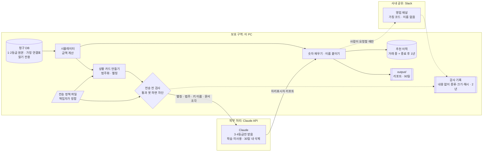

# 데이터 보안 정책과 구조 (v1.4, 2026-11-07 G1 변경 3 승인)

| 버전 | 날짜 | 내용 |
|---|---|---|
| v1 | 2026-11-07 | 데이터 분류, 보안 구역, 통제 목록, 상황 카드, 전송 전 검사, 감사 기록, 고객 안내 요약 |
| v1.1 | 2026-11-07 | 현업 기준 재검토 결정 반영: 전송 정책 파일 분리, Slack에는 이름 대신 고정 가칭 코드, 데이터별 보관 기간, 추천 이력 신설 |
| **v1.2** | 2026-11-07 | **고객 대상 제품으로 범위 변경(명세 v3.0)**: 고객 질문의 개인정보 가림, AI 상담 고지, 고객용·내부용 문서 분리, 셀프 변경 권한, 광고성 정보 발송 조건, 서류 발행 통제, 상담 기록 보관 |
| v1.3 | 2026-11-07 | 성수기 분석(명세 v3.2): 분석 범위 24개월, 상황 카드의 성수기 범주, 고객 안내 10번, 12장 "긴 기간 패턴 분석"을 범위 안으로 |
| v1.4 | 2026-11-07 | Azure 시연 배포(명세 v3.3 DEP), 개발 하네스 보호 파일(HAR), CI의 비밀값 검사, 통제 S21~S24 |

이 문서는 과금 추천 에이전트가 고객 데이터를 어떻게 다루는지 정합니다. 읽는 사람은 셋입니다.

- **개발자**: 무엇을 만들어야 하는지 → 4~9장
- **보안·법무 검토자**: 무엇이 어디로 가고 얼마나 남는지 → 2, 3, 7, 8, 11장
- **고객**: 내 데이터가 안전한지 → 0장

요구사항 ID(SEC-xx 등)는 [requirements.md](requirements.md)를 따릅니다. 이 프로젝트의 데이터는 모두 가상 데이터이지만(SEC-02), 통제는 실제 고객 데이터를 다룬다고 가정하고 설계합니다.

## 0. 고객 안내 요약

고객에게 그대로 보여줄 수 있도록 쓴 요약입니다. 아래 문장은 모두 테스트나 감사 기록으로 확인할 수 있는 것만 적었습니다.

> **요금제 추천 분석에서 고객님의 데이터는 이렇게 다뤄집니다**
>
> 1. 고객님의 회사 이름, 고객 번호, 이용량, 청구 금액은 **회사 밖의 AI 서비스로 보내지 않습니다.** AI에는 "API 사용량이 기본 제공량을 2~5배 넘음" 같은 범주 정보와, 실행할 때마다 새로 정하는 임시 별칭만 전달됩니다.
> 2. 금액 계산은 AI가 아니라 회사 내부의 계산 프로그램이 합니다. 리포트의 숫자는 이 프로그램의 결과로만 채워집니다.
> 3. AI로 나가는 모든 요청은 보내기 직전에 자동으로 검사합니다. 고객 정보가 섞여 있으면 보내지 않고 멈춥니다.
> 4. 누가, 언제, 어떤 분석을 했는지, 외부로 무엇이 나갔는지 기록합니다. 기록에는 내용이 아니라 종류와 크기만 남깁니다.
> 5. 분석 결과는 담당자가 확인한 뒤에만 사내 채널로 공유됩니다. 이때도 회사 이름 대신 의미 없는 고객 코드를 쓰고, 실제 이름은 권한 있는 담당자만 사내 화면에서 확인합니다.
> 6. 분석 리포트는 90일이 지나면 삭제합니다. 언제든 원본 데이터로 다시 만들 수 있기 때문입니다.
> 7. 상담 화면의 답변은 AI가 작성합니다. AI는 승인된 안내 문서에 근거가 있을 때만 답하고 근거를 함께 보여 드립니다. 계약·환불·해지처럼 중요한 질문이나 근거가 없는 질문은 AI가 답하지 않고 담당자에게 연결합니다.
> 8. 상담 질문에 적으신 연락처나 계좌번호 같은 개인정보는 AI와 사내 메신저로 보내기 전에 자동으로 가립니다.
> 9. 요금제 변경은 결제 권한이 있는 분이 확인 화면에서 직접 요청할 때만 접수되며, 적용일 전까지 취소할 수 있습니다. 확인 화면과 서류의 금액은 AI가 아니라 계산 프로그램의 값입니다.
> 10. 해마다 사용량이 늘어나는 달(성수기)을 미리 알려 드리기 위해 최근 24개월 이용 기록을 회사 안에서 분석합니다. 회사 밖의 AI에는 성수기가 있다는 사실과 증가 정도의 범주만 전달되고, 성수기 월과 사용량은 전달되지 않습니다.

## 1. 원칙

개인정보보호위원회의 생성형 AI 안내서(2025-08)가 권장하는 **개인정보 안심설계(Privacy by Design)**를 따릅니다. 보안을 나중에 덧붙이지 않고 구조에 넣습니다.

1. **최소 전송**: 외부로는 판단에 꼭 필요한 정보만, 가장 거친 형태로 보냅니다.
2. **가명 처리**: 외부로 가는 요청에는 고객을 알아볼 수 있는 값이 없습니다.
3. **기본 차단(fail-closed)**: 검사를 통과하지 못하면 보내지 않습니다. "일단 보내고 나중에 확인"은 없습니다.
4. **기록과 증명**: 무엇이 나갔는지 나중에 보여줄 수 있어야 합니다.
5. **사람 확인**: 회사 밖이나 사내 채널로 결과를 내보내는 일은 사람이 요청할 때만 합니다.
6. **정책과 코드의 분리**: 무엇을 외부로 보낼지는 개발자가 코드로 정하지 않습니다. 정보보호·개인정보 책임자가 정책 파일로 정하고, 바꿀 때는 승인 기록을 남깁니다(5.1).
7. **목적에 맞는 보관 기간**: 데이터마다 보관 목적을 적고, 그 목적에 필요한 기간만 보관합니다(8장).

## 2. 데이터 분류

| 등급 | 항목 | 저장 위치 | Claude API로 | Slack으로 |
|---|---|---|---|---|
| **1. 식별 정보** | 고객 이름, 고객 ID, 가입일. 실무라면 담당자 이름·연락처, 사업자등록번호 | DB | **금지** | **금지**. 가칭 코드만 보냄(SEC-12) |
| **1. 식별 정보(연결표)** | 가칭 코드와 고객 ID의 연결표 | DB(`customer_codes`) | **금지** | **금지** |
| **2. 고객 수치** | 월별 이용량, 활동일, 가입 기간, 청구액, 절감액, 절감률 | DB, 계산 결과 | **금지**(SEC-07) | 허용(가칭 코드와 함께, 사내 영업 채널 전제) |
| **2. 추천 이력** | 가칭 코드, 날짜, 추천 요금제·이벤트, 절감액, 수락 여부, 모델 ID | 앱 저장소(`data/app.db`) | **금지** | 해당 없음 |
| **가칭 코드** | Slack용 고정 코드(예: `K7Q-2F9`) | DB(`customer_codes`) | **금지**(여러 분석을 한 고객으로 이어 붙일 수 있음) | 허용 |
| **3. 파생 범주** | 초과 정도 구간, 절감 규모 구간, 이탈 위험 여부, 추천 안정성 | 계산할 때만 만듦 | 허용(별칭과 함께) | 허용 |
| **4. 사내 공개** | 요금제·이벤트 목록, 지식 문서(가상) | DB, `knowledge/` | 허용 | 허용 |
| **1. 고객 질문 원문 (v1.2)** | 상담 화면에 고객이 적은 글. 연락처·계좌번호·이름 등이 섞일 수 있음 | app.db `tickets`(가린 형태) | 가린 형태만(ASK-05) | 가린 요약만(ESC-02) |
| **2. 서류 (v1.2)** | 비용 절감 검토서, 변경 확인서(고객 이름, 금액) | 만들 때만 생성, 발행 기록은 app.db `documents` | **금지** | **금지**(서류 자체는 보내지 않음) |
| **2. 변경 접수 (v1.2)** | 변경 전후 요금제, 적용일, 요청자 역할 | app.db `change_requests`(시연에서는 모의 청구 시스템) | **금지** | 가칭 코드와 요약만(CHG-06) |
| **비밀값** | API 키, Webhook URL | `.env`만 | 해당 없음 | 해당 없음 |

비밀값은 저장소, 실행 기록, 감사 기록, 화면 어디에도 남기지 않습니다(SEC-01, 04, 09).

## 3. 보안 구역과 데이터 흐름



- **보호 구역(이 PC)**: 원본 데이터, 계산, 별칭과 실제 ID의 연결, 최종 리포트가 모두 여기 있습니다.
- **외부 처리(Claude API)**: 상황 카드와 가상 문서 조각만 받습니다. 고객 수치를 받지 않으므로, 리포트에 숫자를 쓸 수도 없습니다. 숫자는 보호 구역에서 코드가 채웁니다(REP-02).
- **사내 공유(Slack)**: 검증을 통과한 리포트를 사람이 요청할 때만 보냅니다. 고객은 가칭 코드로만 나타나고, 담당자는 사내 화면에서 코드를 조회해 실제 이름을 확인합니다. 알림과 상세 정보를 나누는 방식입니다(SEC-16).


### 3.1 개발 도구의 범위

개발 중에는 Claude Code가 `.mcp.json`으로 MCP 서버(`billing-tools`)에 바로 연결해 도구를 시험합니다. 이 경로는 상황 카드와 전송 전 검사(`guard.py`)를 **거치지 않습니다.** 도구 결과(고객 ID, 이용량, 금액)가 그대로 Claude로 갑니다.

- 이 연결은 **가상 데이터(SEC-02)로 개발할 때만** 씁니다.
- 실제 고객 데이터가 담긴 DB에는 이 방식으로 연결하지 않습니다. 실제 데이터는 `agent.py` → `guard.py` 경로로만 다룹니다.
- 실무에서는 개발 환경과 운영 데이터를 분리하는 것으로 이 원칙을 지킵니다. 개발 PC에는 가상 데이터나 가명 처리된 데이터만 둡니다.
## 4. 보안 통제 목록

| ID | 정책 | 구현 장치 | 확인 방법 | 요구사항 |
|---|---|---|---|---|
| S1 | 최소 전송 | 상황 카드(5장)만 보냄 | 카드에 2등급 값이 없는지 테스트 | SEC-07 |
| S2 | 가명 처리 | 실행마다 새 별칭(`C1`), 연결은 메모리에만 | 요청에 고객 ID가 없는지 테스트 | SEC-05 |
| S3 | 전송 전 검사 | 모든 Claude 요청을 보내기 직전에 검사(6장) | 일부러 이름·ID·수치를 넣은 요청이 차단되는지 테스트 | SEC-08 |
| S4 | 이름 미전송 | MCP 도구가 이름을 돌려주지 않음, 이름은 마지막에 코드가 붙임 | 기존 테스트 + 요청 검사 | SEC-03 |
| S5 | 데이터 변경 차단 | DB 읽기 전용 연결, SQL을 받는 도구 없음 | 기존 테스트 | RET-01, 02 |
| S6 | 접근 범위 | 화면은 `127.0.0.1`에서만 열림 | 설정 파일 확인 | UI-01 |
| S7 | 비밀값 관리 | `.env`로만 읽음, 저장소 비밀값 검사 | 저장소 파일에 키·Webhook 형식이 없는지 테스트 | SEC-01, 04, 09 |
| S8 | 저장 최소화 | 데이터별 보관 기간(8장), 기간이 지난 파일·이력을 지우는 명령 | 저장소 제외 확인, 삭제 명령 테스트 | SEC-10, 15 |
| S9 | 감사 기록 | 분석·외부 전송·Slack 전송을 추가 전용 기록에 남김(9장) | 기록에 본문·비밀값이 없는지 테스트 | SEC-11 |
| S10 | 사내 공유 통제 | 이름 대신 고정 가칭 코드, 실제 이름은 사내 화면 조회로만(조회 기록), 검증 통과 + 사람 요청 + 처음 보내는 리포트만 | Slack JSON에 이름·고객 ID가 없는지, 조회가 감사 기록에 남는지 테스트 | SEC-12, 16, NTF-02~04 |
| S11 | 프롬프트 인젝션 대비 | 지시문 문구, 문서 조각 구분 표시. Claude가 쓸 수 있는 도구는 읽기 전용 검색 하나뿐 | 테스트 | SEC-06, AGT-01 |
| S12 | 외부 처리자 조건 | 허용 모델 목록, 상업 API 키로만 호출(7장) | 허용 목록 밖 모델이면 실행을 거부하는 테스트 | SEC-13 |
| S13 | 정책과 코드 분리 | 전송 기준·범주 구간·허용 모델·보관 기간을 정책 파일에 둠. 바꾸면 승인자·사유를 감사 기록에 남김 | 정책 파일 값을 바꾸면 카드와 검사가 따라 바뀌는지, 승인 정보 없이 바꾼 파일이면 실행하지 않는지 테스트 | SEC-14 |
| S14 | 고객 질문의 개인정보 가림 (v1.2) | 전화번호·이메일·사업자등록번호·주민등록번호·계좌번호 형식과 DB의 고객 이름을 `[가림]`으로, 숫자는 `[숫자]`로 바꾼 뒤에만 Claude·Slack으로 보냄 | 형식별 예시 질문이 모두 가려지는지 테스트 | ASK-05 |
| S15 | 고객용·내부용 문서 분리 (v1.2) | 문서 `audience` 메타데이터, 고객 상담은 고객용만 검색 | 고객 상담 검색 결과에 내부용 조각이 없는지 테스트 | KNW-07 |
| S16 | AI 사용 고지 (v1.2) | 상담 화면 첫머리와 답변마다 AI 작성 표시 | 화면 테스트 | ASK-01 |
| S17 | 위험 질문은 사람에게 (v1.2) | 코드 규칙으로 위험 주제·이상한 요청을 분류해 Claude를 부르지 않고 연결. 주제 목록은 정책 파일 | 위험 질문 세트를 AI가 하나도 답하지 않는지(EVAL-06) | ASK-02, 03 |
| S18 | 결제 행위 통제 (v1.2) | AI는 변경 실행 불가, 결제 권한자만 변경·취소, 변경 직전 재계산, 같은 접수 두 번 방지, 적용 전 취소 | 테스트 | CHG-01~07 |
| S19 | 광고성 정보 발송 조건 (v1.2) | 수신 동의 확인, 야간(21~08시) 발송 금지, 수신거부 방법 표시. 시연은 미리보기만 | 미리보기에 수신거부 문구가 있는지 테스트 | PRO-04 |
| S21 | 클라우드 비밀값 (v1.4) | API 키·Webhook은 Key Vault, 앱은 관리 ID로 읽음. 배포 코드에 비밀값 없음 | 저장소 비밀값 검사가 배포 코드도 검사 | DEP-02, SEC-09 |
| S22 | 공개 주소 통제 (v1.4) | 배포한 화면은 로그인 필수, 가상 데이터만, 시연 때만 켜고 끝나면 삭제, 예산 알림 | 스모크 테스트에서 로그인 없이 접근이 막히는지 확인, 올림·내림 기록 | DEP-03, 04 |
| S23 | 개발 도구 통제 (v1.4) | 훅이 `.env` 읽기·쓰기, `.mcp.json`, 하네스 파일, 감사 기록 변경을 막음 | 훅 테스트 | HAR-02 |
| S24 | 자동 검사 (v1.4) | 저장소에 올릴 때마다 CI가 테스트(비밀값 검사 포함)를 돌림 | GitHub Actions 기록 | OPS-01 |
| S20 | 서류 발행 통제 (v1.2) | 본인 고객의 서류만 생성, 보호 구역에서만 생성, 문서 번호·해시를 기록 | 다른 고객 서류 요청 거부, 해시 기록 테스트 | DOC-05, 07 |

## 5. 상황 카드: Claude가 받는 고객 정보의 전부

Claude는 숫자를 쓰지 않으므로(REP-02) 정확한 값이 필요 없습니다. 무엇을 검색하고 어떻게 설명할지 정하는 데는 범주만으로 충분합니다. `user_002`의 예입니다.

```
고객: C1
현재 요금제: 베이직 → 추천: 프로 (상향) + 이벤트 "프로 전환 3개월 30% 할인"
초과 원인: API 사용량이 기본 제공량의 2~5배, 스토리지 사용량이 기본 제공량의 2~5배
절감 규모: 10~50%
추천 안정성: 안정 (사용량이 20% 줄거나 늘어도 같은 추천)
이탈 위험: 없음 / 기록 부족: 없음
받을 수 없는 이벤트:
  - "베이직 2년 이상 고객 2개월 1만 원 할인": 가입 기간 조건 미달
  - "여름 프로 50% 할인(종료)": 이벤트 기간 종료
쓸 수 있는 자리표시자: {current_plan} {current_monthly} {avg_api_calls} ... (값 없이 이름만)
```

| 항목 | 범주 | 원래 값(보내지 않음) |
|---|---|---|
| 초과 정도 | 기본 제공량 이내 / 2배 미만 / 2~5배 / 5배 이상 (API, 스토리지 각각) | 실제 사용량, 제공량 대비 비율 |
| 절감 규모 | 없음 / 10% 미만 / 10~50% / 50% 이상 | 절감액, 절감률 |
| 받을 수 없는 이벤트의 이유 | 가입 기간 조건 미달 / 상위 전환에만 적용 / 이벤트 기간 종료 | "이용 24개월 이상 필요(현재 19개월)"처럼 가입 기간이 들어간 문구 |
| 추천 안정성 | 안정 / 사용량이 줄면 바뀜 / 사용량이 늘면 바뀜 | 바뀐 경우의 금액 |
| 이탈 위험, 기록 부족 | 있음 / 없음 | 활동일, 기록 개월 수 |
| 성수기 (v1.3) | 없음 / 있음(증가 1.3~2배) / 있음(증가 2배 이상), 예측 방법(3개월 평균 / 계절 반영) | 성수기 월, 달별 사용량과 배수. 성수기 월·마감일·성수기 청구액은 자리표시자(`{peak_months}` 등)로 PC 안에서 채움 |

요금제 이름과 이벤트 이름은 4등급(사내 공개)이라 그대로 보냅니다. 이벤트 이름에 들어 있는 숫자("3개월 30%")는 고객 정보가 아니라 상품 정보입니다.

**리포트 설명이 부족할 때의 규칙**: 정확한 값을 보내는 대신 구간을 더 잘게 나눕니다(예: 2~3배, 3~5배). **비율(예: "기본 제공량의 4.2배")은 보내지 않습니다.** 요금제의 기본 제공량은 공개 정보라서, 비율과 요금제 이름이 있으면 실제 사용량을 거꾸로 계산할 수 있습니다.

### 5.1 전송 정책 파일

위 범주와 전송 기준은 코드가 아니라 `config/data_policy.toml`에 둡니다. 회사마다 데이터 분류 기준이 다르므로, 코드를 고치지 않고 정책 담당자가 기준을 바꿀 수 있게 하기 위해서입니다.

```toml
[approval]                      # 이 파일을 승인한 사람과 날짜. 비어 있으면 실행하지 않음
approved_by = "정보보호책임자"
approved_at = "2026-11-07"
reason = "초기 정책"

[external_ai]                   # Claude로 보낼 수 있는 항목
send_customer_numbers = false   # 고객 수치(이용량·금액 등). true로 바꾸려면 별도 승인 필요
send_ratios = false             # 제공량 대비 비율. 역산 가능하므로 기본 금지
allowed_models = ["claude-sonnet-5-5"]

[categories]                    # 범주 구간
overage_multiples = [1, 2, 5]   # 이내 / 2배 미만 / 2~5배 / 5배 이상
saving_pct = [10, 50]           # 10% 미만 / 10~50% / 50% 이상
stability_change_pct = 20

[retention_days]                # 8장 보관 기간
reports = 90
run_logs = 90
audit = 730
history_after_contract_end = 365
```

- `agent.py`는 시작할 때 이 파일을 읽고, 파일 내용의 해시를 감사 기록에 남깁니다. 해시가 바뀌었으면 "정책 변경"으로 따로 기록합니다.
- 승인 정보(`[approval]`)가 비어 있으면 실행하지 않습니다.
- 이 파일은 저장소에 넣습니다. 비밀값이 없고, 변경 이력이 남아야 하기 때문입니다.

## 6. 전송 전 검사 규칙

`agent.py`가 Claude API를 부르기 직전에, 보낼 요청 전체(지시문, 상황 카드, 검색 결과, 이전 대화)를 검사합니다. 하나라도 걸리면 **보내지 않고** 오류로 끝내며, 감사 기록에 "차단"과 걸린 규칙을 남깁니다.

1. DB에 있는 **모든 고객 이름**(지금 200개)이 들어 있지 않을 것. 분석 중인 고객의 이름만 보지 않는 것은, 다른 고객 이름이 섞이는 실수도 막기 위해서입니다.
2. 고객 ID 형식(`user_` + 숫자 3자리)과 Slack용 가칭 코드 형식이 없을 것. 가칭 코드는 고정이라, 외부로 나가면 여러 분석을 한 고객으로 이어 붙일 수 있습니다.
3. 숫자는 **허용 목록**에 있는 것만 있을 것. 허용 목록은 다음 숫자들입니다.
   - 요금제·이벤트 목록과 지식 문서에 이미 있는 숫자(상품 정보)
   - 상황 카드의 고정 범주 문구에 들어 있는 숫자("2~5배", "10% 미만", "20% 줄거나 늘어도" 등). 이 문구는 고객마다 바뀌지 않는 코드 상수입니다.
   - 별칭 번호와 자리표시자 이름 안의 숫자(`{saving_12m}`의 12)
4. 이메일, 전화번호, 사업자등록번호 형식이 없을 것. 지금 데이터에는 없지만, 실무 데이터가 들어올 때를 대비합니다.
5. (v1.2) 고객 질문은 S14의 가림 처리를 거친 형태만 있을 것. 가림 처리 전의 원문이 요청에 섞이면 차단합니다. 금액 질문은 코드가 시뮬레이터 값으로 답하므로, 질문 속 숫자를 Claude에 보낼 필요가 없습니다.

상황 카드는 코드가 만들기 때문에 정상이라면 이 검사에 걸릴 일이 없습니다. 이 검사는 **코드 실수에 대한 안전망**입니다. 예를 들어 나중에 누군가 카드에 이용량을 추가하면, 그 값이 외부로 나가기 전에 막힙니다.

알려진 한계: 고객 수치가 우연히 허용 목록의 숫자와 같으면(예: 가입 기간 3개월과 이벤트 이름의 "3개월") 이 규칙으로는 구별하지 못합니다. 그래서 1차 방어는 카드에 고객 수치를 넣지 않는 것(S1)이고, 검사는 2차 방어입니다.

## 7. 외부 처리자: Claude API

공식 정책(2026-11-07 확인)과 이 프로젝트의 대응입니다.

| 항목 | 공식 정책 | 이 프로젝트 |
|---|---|---|
| 학습 사용 | 상업 이용 약관상 API로 보낸 고객 데이터는 학습에 쓰지 않음 | 개인 구독 계정이 아닌 상업 API 키로만 호출(SEC-13) |
| 보존 기간 | API 입력·출력은 받은 날로부터 30일 안에 자동 삭제. 예외: 별도 합의(ZDR 등), 이용 정책 위반 대응, 법령 준수 | 애초에 고객 식별 정보·수치를 보내지 않으므로, 30일 동안 남는 것은 별칭과 범주 정보뿐 |
| 무보존(ZDR) | 별도 계약으로 가능 | 실무 도입 시 검토 항목(12장) |
| 예외가 붙는 모델 | 일부 모델(Covered Models)은 안전 검토를 위해 제한적 보존이 필수 | 허용 모델 목록으로 이런 모델을 쓰지 않음(SEC-13) |

정책은 바뀔 수 있으므로, 실무 도입 전에는 그때의 상업 이용 약관과 데이터 처리 부속서(DPA)를 다시 확인합니다.

## 8. 저장·보관·삭제

**보관 기간은 보관 목적에서 나옵니다.** "패턴을 몇 개월치 읽느냐"는 보관 기간이 아니라 분석 설계의 문제입니다. 패턴 분석은 청구 시스템의 원천 이용 기록을 읽어서 하고, 이 앱이 만든 리포트는 원천 데이터로 언제든 다시 만들 수 있습니다. 그래서 리포트는 짧게, 다시 만들 수 없는 추천 이력은 길게 보관합니다.

| 무엇 | 어디 | 들어 있는 것 | 보관 | 목적과 근거 |
|---|---|---|---|---|
| 원천 이용·청구 데이터 | 청구 시스템(실습에서는 `database/billing_mock.db`) | 1·2등급 전부 | **청구 시스템 정책을 따름**(이 앱이 정하지 않음) | 법정 보존 기간이 적용됩니다. 상법상 상업장부·영업 중요서류 10년, 세법상 장부·증빙 5년, 전자상거래에 해당하면 대금결제 기록 5년. 실습 DB는 `init_db.py`로 다시 만들고 저장소에서 제외 |
| 가칭 연결표 | 청구 DB의 `customer_codes`(실무에서는 CRM 고객번호 체계) | 가칭 코드 ↔ 고객 ID | 고객 정보와 같음 | 사람이 같은 고객을 계속 추적하기 위해 |
| **추천 이력** | `data/app.db`의 `recommendation_history`(앱 전용, 저장소 제외) | 가칭 코드, 날짜, 추천 요금제·이벤트, 절감액, 수락 여부, 모델 ID. 이름·문장 없음 | **거래하는 동안 + 거래 종료 후 1년.** 그 뒤에는 개별 고객을 알아볼 수 없는 통계만 남김 | 추천 수락률·패턴 분석. 다시 만들 수 없는 정보 |
| 리포트, Slack JSON | `output/` | 이름, 금액, 문장 | **90일** | 분기 단위 영업 주기. 원천 데이터로 다시 만들 수 있음. 고객에게 실제 제출한 제안서는 회사 문서관리 규정을 따름 |
| 실행 기록 | `output/runs/` | 별칭, 단계별 요약, 시간, 모델 ID. 이름·비밀값 없음 | **90일** | 운영·품질 점검 |
| 감사 기록 | `logs/audit.jsonl` | 9장 형식. 본문·이름·비밀값 없음 | **2년** | 개인정보처리시스템 접속기록은 1년 이상, 5만 명 이상 또는 고유식별·민감정보를 처리하면 2년 이상 보관 의무(개인정보의 안전성 확보조치 기준 제8조). 실무 청구 시스템 규모를 고려해 2년 |
| 전송 기록 | `logs/sent_log.json` | 리포트 해시, 시각 | 2년 | 감사 기록과 같음 |
| 상담 기록 (v1.2) | app.db `tickets` | 가린 질문, 답변, 처리 상태 | **상담 종료 후 3년** (2026-11-07 확정) | 분쟁 대응과 FAQ 개선. 법정 기간 해당 여부는 법무 확인 |
| 변경 접수 (v1.2) | app.db `change_requests`(시연), 실무에서는 청구 시스템 | 변경 전후 요금제, 적용일, 요청자 역할 | 청구 시스템 정책을 따름 | 계약 변경 기록이라 거래 기록의 법정 보존 기간이 적용될 수 있음 |
| 서류 파일 (v1.2) | 내려받을 때 생성, 저장하지 않음 | 고객 이름, 금액 | 보관 안 함. 발행 기록(문서 번호·해시)만 추천 이력과 같은 기간 | 같은 입력이면 같은 내용으로 다시 만들 수 있음(DOC-06) |
| Claude 측 | Anthropic | 별칭, 범주, 문서 조각 | 30일 이내 삭제(ZDR 계약 시 보존 안 함) | 7장 |

삭제는 `python src/agent.py --purge` 한 명령으로 합니다. 정책 파일의 기간을 읽어 기간이 지난 리포트·실행 기록·이력을 지우고, 삭제 건수를 감사 기록에 남깁니다. 법정 기간과 회사 규정은 실무 도입 때 보안·법무 담당자가 최종 확인합니다.

## 9. 감사 기록 형식

추가만 하고 고치거나 지우지 않는 JSON Lines 파일입니다. **내용은 남기지 않고, 무엇이 있었는지만 남깁니다.**

| 사건 | 남기는 항목 |
|---|---|
| 분석 요청 | 시각, PC 사용자 이름, 고객 ID, 실행 번호 |
| 외부 전송(Claude) | 시각, 실행 번호, 요청 크기, 요청 본문의 해시, 보낸 항목 종류(카드/문서 조각), 검사 결과(통과/차단과 규칙), 모델 ID, 사용 토큰 |
| 검증 결과 | 시각, 실행 번호, 통과/거부와 이유의 종류 |
| Slack 전송 | 시각, 실행 번호, 리포트 해시, 요청한 PC 사용자 |
| 삭제 | 시각, 삭제한 파일·이력 수, 기준 날짜 |
| 정책 변경 | 시각, 정책 파일 해시(변경 전·후), 승인자, 사유 |
| 실명 조회 | 시각, PC 사용자 이름, 조회한 가칭 코드 |
| 수락 여부 기록 | 시각, PC 사용자 이름, 가칭 코드, 기록한 값 |

본문 해시를 남기면 "이 날 이 요청이 나갔다"를 나중에 증명할 수 있습니다. 내용 자체는 남지 않습니다.

## 10. 사고 대응

| 상황 | 할 일 |
|---|---|
| API 키가 노출됨(저장소, 화면 캡처 등) | 즉시 Claude Console에서 키를 폐기하고 새로 발급. 감사 기록에서 노출 이후 사용 내역 확인 |
| 전송 전 검사에서 차단 발생 | 실행 중단(자동). 감사 기록의 규칙을 보고 원인 코드 수정. 수정 후 해당 규칙 테스트 추가 |
| Slack에 잘못된 리포트가 감 | Slack에서 메시지 삭제. 전송 기록과 감사 기록으로 범위 확인. 원인이 검증 누락이면 검증 테스트 추가 |
| Webhook URL 노출 | Slack에서 Webhook 폐기 후 재발급 |
| (v1.2) 고객이 상담 질문에 민감한 정보를 적음 | 자동 가림(S14). 가림 누락이 발견되면 해당 접수의 Slack 메시지를 지우고 가림 규칙에 형식을 추가한 뒤 테스트 추가 |
| (v1.2) 잘못된 금액으로 셀프 변경이 접수됨 | 적용일 전이면 취소하고 고객에게 연락. 재계산·확인 화면 값과 시뮬레이터 값을 대조해 원인 확인 |
| 가칭 연결표 노출 | 모든 고객의 가칭 코드를 새로 발급하고, 이전 코드가 들어간 Slack 메시지의 범위를 감사 기록으로 확인 |

## 11. 규정·지침과의 관계

법률 자문이 아니라, 설계가 어떤 권고를 염두에 두었는지 정리한 표입니다. 실무 도입 전에는 회사의 보안·법무 담당자 검토가 필요합니다.

개인정보보호위원회의 「생성형 인공지능(AI) 개발·활용을 위한 개인정보 처리 안내서」(2025-08)는 API로 상용 모델을 쓰는 방식을 "서비스형 LLM 활용"으로 분류합니다. 시스템 수준의 안전조치로는 외부 API 연동 시 접근 통제, 입·출력 필터, RAG 등 외부 DB 활용 시 추가 안전조치를 권고합니다.

| 권고 | 이 프로젝트 |
|---|---|
| 개인정보 안심설계(PbD) | 1장 원칙, 이 문서 자체 |
| 외부 API 연동 시 접근 통제 | 상업 API 키, 허용 모델 목록, Claude가 쓸 수 있는 도구는 읽기 전용 검색 하나(S11, S12) |
| 입력 필터 | 상황 카드 + 전송 전 검사(S1, S3) |
| 출력 필터 | 리포트 검증: 자리표시자, 인용, 필수 항목(REP-01~05) |
| RAG 활용 시 추가 안전조치 | 지식 문서는 가상·금액 없음·메타데이터 대조, 조각 구분 표시(KNW-03, 05, SEC-06) |
| 가명 처리 | 별칭(S2) |
| 개인정보 흐름 파악 | 2장 분류, 3장 흐름도 |

**(v1.2) 고객 대상 제품이 되면서 추가로 확인할 규정**

| 규정 | 내용 | 이 프로젝트 |
|---|---|---|
| 인공지능 기본법(2026-01-22 시행) 투명성 의무 | 생성형 AI 기반 서비스라는 사실을 이용자에게 미리 알려야 함 | 상담 화면 고지(S16, ASK-01) |
| 정보통신망법 제50조(영리목적 광고성 정보 전송 제한) | 수신자의 사전 동의, 일부 예외(거래관계 등), 야간 전송 제한, 수신거부 방법 표시 | 발송 조건(S19, PRO-04). 요금제 추천 알림이 광고성 정보에 해당하는지와 예외 적용은 법무 확인 |

**국외 이전**: Claude API 서버는 국외에 있습니다. 이 구조에서는 식별 정보와 고객 수치를 보내지 않으므로 국외로 가는 것은 별칭과 범주 정보뿐입니다. 이것이 개인정보에 해당하는지, 고객이 법인이 아닌 개인사업자일 때는 어떤지 등은 실무에서 법무 검토로 확정할 사항입니다.

## 12. 실무 확장 (지금 범위 밖)

| 항목 | 내용 |
|---|---|
| 로그인과 권한 | 영업 담당자는 담당 고객만 조회. 지금은 PC 한 대, 사용자 한 명이라 생략 |
| 무보존(ZDR) 계약 | 외부 처리자에 아무것도 남지 않게 함 |
| 사내 AI 게이트웨이 | 회사의 모든 AI 요청을 한 곳에서 검사·기록. 이 프로젝트의 전송 전 검사를 회사 단위로 옮긴 것 |
| 내부 모델과의 혼합 | 민감도가 높은 단계는 사내 모델, 나머지는 외부 모델 |
| DB 암호화 | 원본 DB 파일 자체를 암호화 |
| 실명 조회 권한 | 가칭 코드를 실제 이름으로 바꿔 보는 권한을 담당자별로 제한 |
| ~~긴 기간 패턴 분석~~ | (v1.3에서 범위 안으로) 원천 이용 기록을 24개월치 읽어 성수기를 판정. 원천 데이터의 보관 기간은 청구 시스템 정책을 따르고, 앱은 결과(성수기 월)만 남김 |

## 13. 결정 기록

2026-11-07에 사용자가 현업 기준 재검토안에 동의해 확정했습니다.

1. **Claude에는 범주 정보만 보냅니다 (SEC-07).** 기준은 정책 파일로 분리합니다(SEC-14, 5.1). 설명이 부족하면 구간을 더 잘게 나누고, 정확한 값이나 비율은 보내지 않습니다. 리포트 품질은 G3에서 확인합니다.
2. **Slack에는 이름 대신 고정 가칭 코드를 씁니다 (SEC-12, 16).** 일부 가림(`(주)베타**`)은 고객이 200명이면 거의 특정되므로 쓰지 않습니다. 코드는 무작위로 만들고 고객마다 고정합니다. 일련번호(`user_002`)나 이름형 가칭은 쓰지 않습니다. 실제 이름은 사내 화면에서 코드로 조회합니다.
3. **보관 기간은 데이터별로 나눕니다 (SEC-10, 15, 8장).** 리포트·실행 기록 90일, 추천 이력은 거래 중 + 종료 후 1년, 감사 기록 2년, 원천 데이터는 청구 시스템 정책을 따릅니다.

**v1.2 결정 (2026-11-07, 고객 대상 제품으로 범위 변경)**

4. **고객 질문은 가린 뒤에만 외부로 보냅니다 (S14).** 숫자도 가립니다. 금액 질문은 코드가 답하기 때문입니다.
5. **위험 질문은 AI가 답하지 않습니다 (S17).** 해지·위약금, 환불, 계약 예외, 분쟁·법적 문제, 다른 고객 정보, 결제 오류, 개인정보 변경과 이상한 요청으로 시작하고, 상담 접수에 쌓이는 질문으로 목록을 늘립니다.
6. **결제 행위는 AI 없이 사람이 합니다 (S18).**
7. **상담 기록은 상담 종료 후 3년 보관합니다** (2026-11-07 G1 변경 승인 때 확정).

**v1.3 결정 (2026-11-07, 성수기 분석)**

8. **성수기 월은 Claude에 보내지 않습니다.** 성수기 월은 고객 사용 패턴에서 나온 값이라 2등급(고객 수치)과 같이 다룹니다. Claude는 "성수기 있음, 증가 2배 이상" 범주로 설명 방향을 정하고, 월과 마감일과 금액은 자리표시자로 코드가 채웁니다.

**v1.4 결정 (2026-11-07, 과정 자료 대조)**

9. **Azure에는 가상 데이터만 올리고, 시연 때만 켭니다(S22).** 공개 주소는 로그인으로 막고, 비밀값은 Key Vault에만 둡니다(S21). 지역은 한국 중부를 기본으로 합니다.
10. **Microsoft Foundry의 Claude를 쓰게 되면 7장을 다시 확인합니다(DEP-06).** 이 경로에서도 판매·운영 주체가 Anthropic이고 처리 위치 옵션(Azure 호스팅 / Anthropic 호스팅)이 있어, 보관 기간과 처리 지역 조건을 그 경로 기준으로 다시 적어야 합니다.
11. **개발 도구(Claude Code)도 통제 대상입니다(S23).** AI 개발 도구가 비밀값을 읽거나, 감사 기록이나 자기 자신을 막는 훅을 고치지 못하게 합니다.
